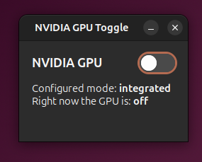

# NVIDIA GPU Toggle

A small desktop app for Ubuntu that switches a laptop's NVIDIA GPU on or off. Turning the GPU off
saves battery when you don't need it. The app uses [envycontrol](https://github.com/bayasdev/envycontrol)
behind the scenes, so you don't need to type terminal commands.



## Will it work on my computer?

It works when:

- The computer has **two GPUs**: a built-in Intel or AMD GPU plus an NVIDIA GPU. NVIDIA calls this
  setup "Optimus", and most laptops with NVIDIA graphics have it. Turning the NVIDIA GPU off is safe
  because the built-in GPU keeps the screen running.
- The **proprietary NVIDIA driver** is installed. It doesn't work with the open-source `nouveau` driver.
- [envycontrol](https://github.com/bayasdev/envycontrol) is installed. It isn't part of Ubuntu by default.

To check your computer, run:

```
lspci | grep -iE 'vga|3d'
```

If it lists both an Intel or AMD GPU and an NVIDIA GPU, the app should work.

**Don't use it on a desktop PC where the NVIDIA card is the only GPU**, or where your monitor is
plugged into the NVIDIA card. Turning the GPU off would leave you with a black screen.

On some laptops the HDMI or USB-C video port is wired to the NVIDIA GPU. An external monitor on that
port won't work while the GPU is off.

## Install

1. Install envycontrol (see its [GitHub page](https://github.com/bayasdev/envycontrol)) and the
   NVIDIA driver if you don't have them.
2. Download or clone this folder, open a terminal in it, and run:

   ```
   ./install.sh
   ```

3. Press the Super (Windows) key, type **gpu**, and open **NVIDIA GPU Toggle**.

The installer adds the app to your app menu for your own user. It works with or without `sudo`.

You can also run the app directly with `./gpu_toggle.py`.

## Usage

- **Switch off:** sets envycontrol to `integrated`. Only the built-in GPU is used, and the NVIDIA GPU
  is powered down.
- **Switch on:** sets envycontrol to `hybrid`. The built-in GPU runs the desktop, and the NVIDIA GPU
  is available for games and other demanding apps.

You'll be asked for your password, then offered a reboot. **The change only takes effect after
rebooting.** The window shows both the mode that's set and whether the GPU is actually on right now.

To use full `nvidia` mode instead of `hybrid` when the switch is on, change `ON_MODE` at the top of
`gpu_toggle.py`.

## Checking manually if the GPU is on or off

Run these in a terminal (after rebooting):

| Command | GPU off | GPU on |
|---|---|---|
| `lspci \| grep -i nvidia` | prints nothing | shows your NVIDIA GPU |
| `lsmod \| grep nvidia` | prints nothing | lists nvidia driver modules |
| `nvidia-smi` | error: couldn't communicate with the NVIDIA driver | table showing the GPU |
| `glxinfo -B \| grep renderer` | Intel or AMD | Intel or AMD in hybrid mode, NVIDIA in nvidia mode |
| `envycontrol --query` | `integrated` | `hybrid` or `nvidia` |

`glxinfo` comes from `sudo apt install mesa-utils`. `envycontrol --query` shows the mode that's set,
which only takes effect after a reboot. The other commands show what is actually running right now.

When copying commands from the raw file, replace `\|` with `|`.

## Troubleshooting

Running `./gpu_toggle.py` from VS Code's built-in terminal can crash with a `libpthread` error when
VS Code is installed as a snap. Start the app from the app menu or a normal terminal instead.
